

  

<h1 align="center">IGLY Spatial: bilingual business website</h1>

  A premium website for a Miami reality capture company serving hotels, resorts and large properties across the Caribbean. 
  Strategy, design, copywriting, SEO and build, from the first sketch to launch.

  <a href="https://www.iglyspatial.com"><strong>www.iglyspatial.com</strong></a>
  &nbsp;·&nbsp; Live since October 2026 &nbsp;·&nbsp; English and Spanish

  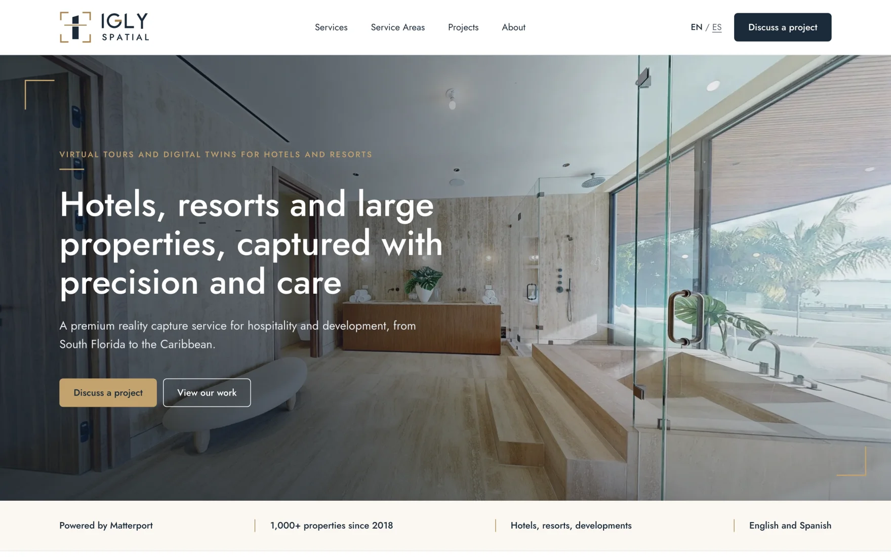

---

## Overview

IGLY Spatial captures properties as walkable 3D digital twins with Matterport Pro3 LiDAR, and delivers virtual tours, floor plans, photography, CAD and BIM files from a single visit. The founders have captured more than 1,000 properties since 2018. In 2026 they relaunched the business with a new focus on hotels, resorts and large properties, from Miami across the Caribbean.

The website had two jobs:

- give the business the credibility to approach hotel groups and resorts;
- turn visitors into enquiries. Every page leads to “Discuss a project”.

**Pro bono project.** I designed and built this website unpaid, as a favor for a friend's business. The source code stays in a private repository; this showcase presents the work with the owners' permission.

---

## My role

I led the project end to end, working directly with the two founders:

- **Strategy:** sitemap, conversion paths, keyword research and a keyword map for every page
- **Design:** wireframes, desktop and phone layouts, motion, the visual system around the existing logo
- **Content:** all copy in English and Spanish, written from facts the founders confirmed
- **Build:** the full site in Astro and TypeScript
- **Launch:** hosting, domain and DNS, the enquiry form, analytics, legal pages, Google Search Console

---

## Highlights

- **28 pages in two languages:** homepage, six service pages from one template, projects, about, contact, a sales page for Caribbean hotels, legal pages, each in English and Spanish with its own addresses (`/es/…`), a language switch and hreflang links
- **Live 3D tours that load on click:** each Matterport tour shows a still image until the visitor starts it, so pages stay fast and nothing third-party loads on arrival
- **Projects with filters:** hotels, residences and construction, each opening in its own window with the live tour, the details and a pre-filled enquiry link
- **A hand-drawn service-areas map** of Florida and the Caribbean, a light SVG built from public-domain coastline data
- **An enquiry form that fills itself in** from where the visitor came from: a service page ticks the service, a project selects the property type. Spam trap included, delivered straight to the business inbox
- **A sales page for Caribbean hotels**, written for marketing, sales and finance teams: sourced market figures, a live booking-commission calculator and an example tour with interactive tags
- **A phone contact bar** that appears after the first screen and steps aside when the page already offers the same buttons

  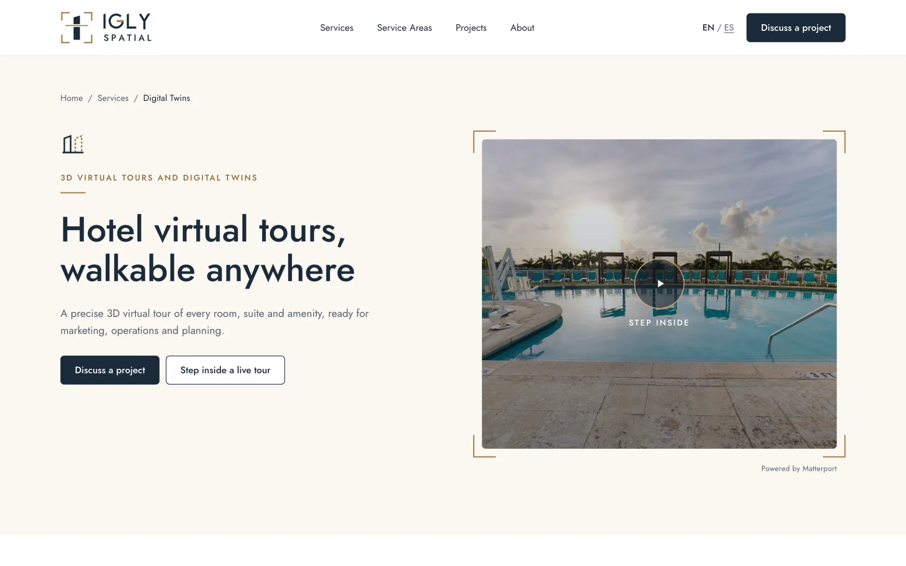
  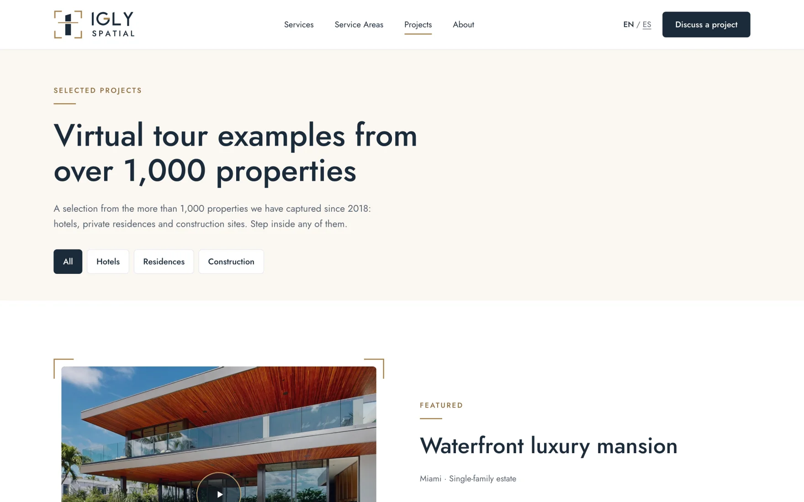

  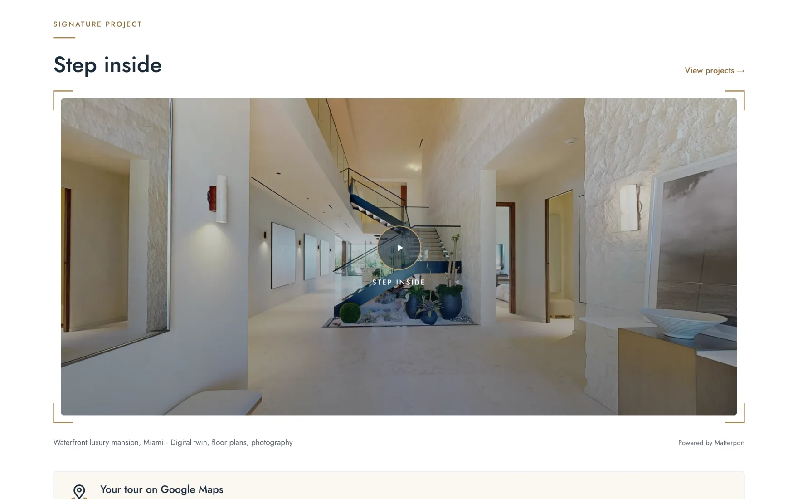
  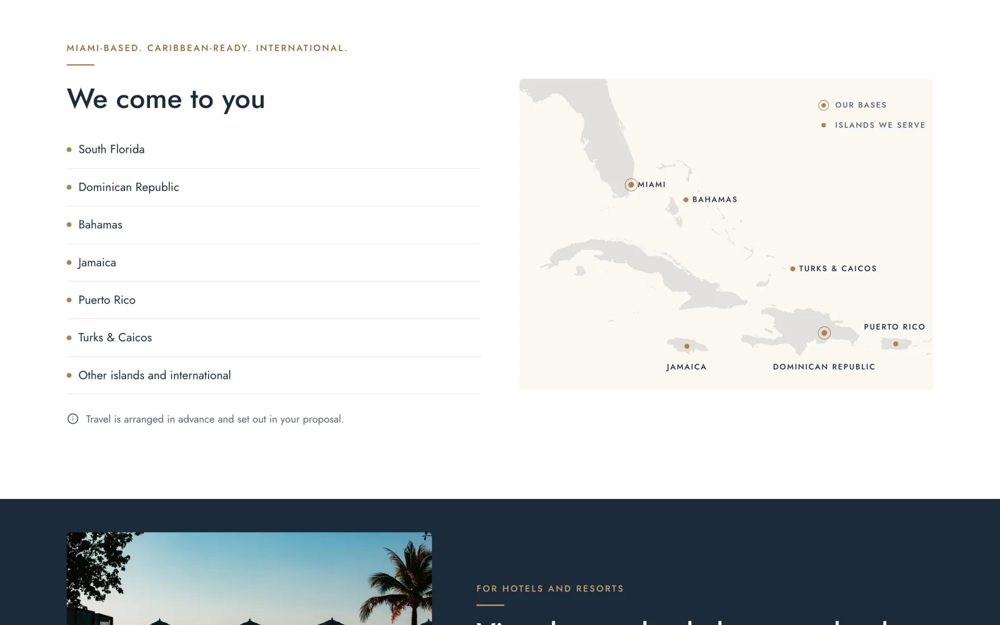

---

## Caribbean hotels page

A dedicated sales page for boutique hotels and resorts, built around evidence rather than adjectives. Every figure carries its source, and no two sources are blended into one estimate.

  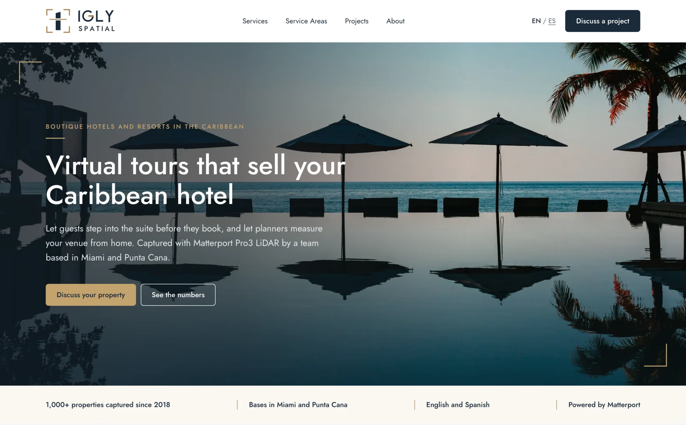

  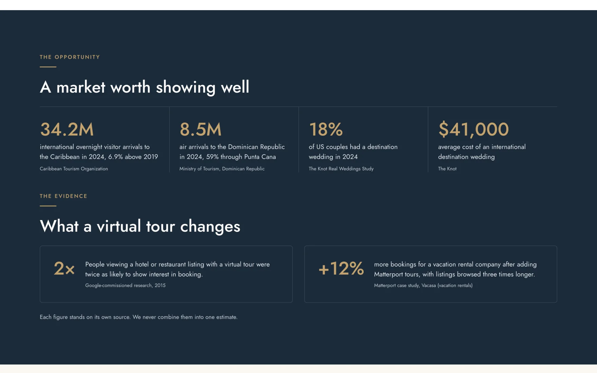
  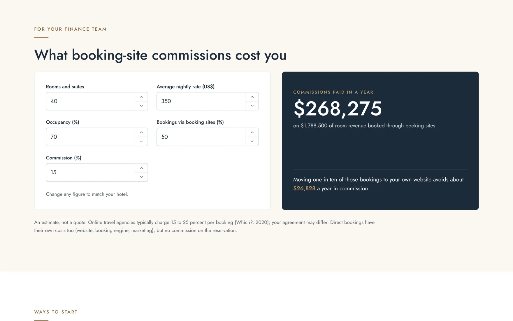

---

## Design

- **Brand:** navy, gold, linen and silver, one typeface (Jost, self-hosted) and a gold “capture frame” from the logo, used around tours and key images
- **Calm and premium:** generous space, alternating linen and white sections, and only the copy each page needs
- **Quiet motion:** content fades in on scroll, gold corners open on hover, accordions open smoothly, pages cross-fade. Opacity and transform only, and all of it switches off under Reduce Motion
- **Phone first:** every page designed for phones as well as desktop, with swipe rows, large touch targets and the contact bar
- **Accessible:** real buttons and links, labelled form fields, visible focus states, a skip link, descriptive image text and readable contrast

  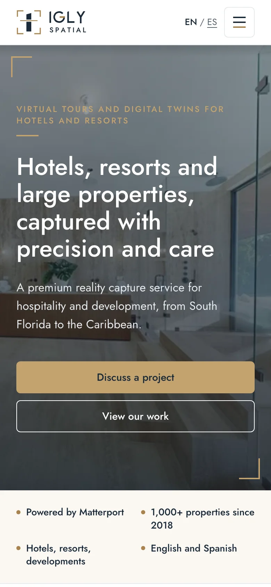
  &nbsp;
  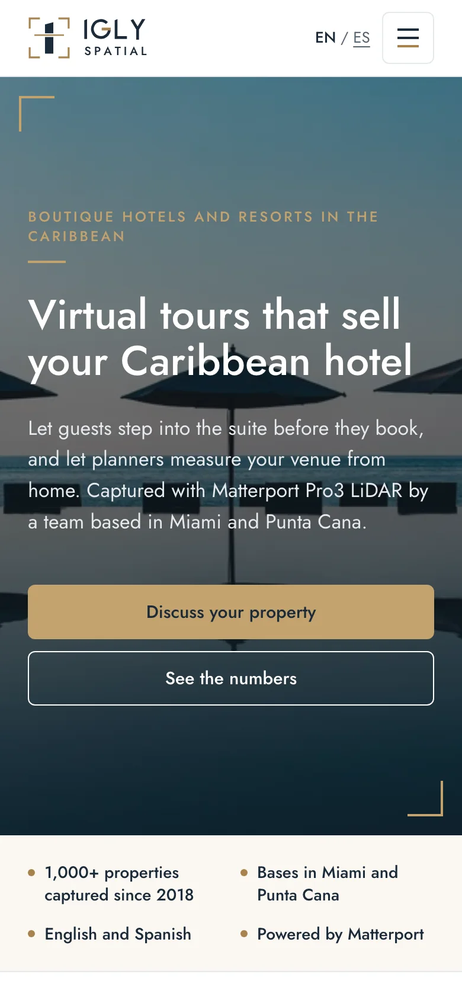
  &nbsp;
  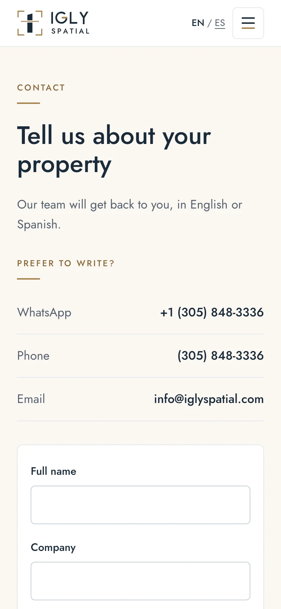

  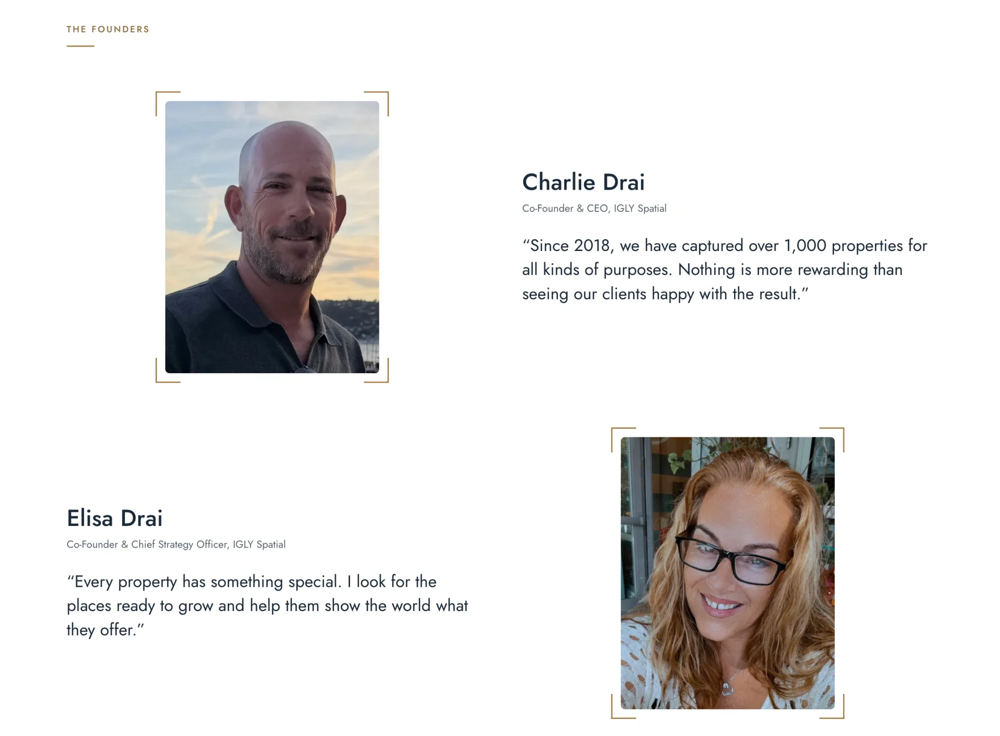

---

## SEO

- Keyword research and a keyword map for every page, built around phrases with real demand and beatable competition (for example “hotel virtual tour”), in English and Spanish
- Unique titles and descriptions, one H1 per page, link previews for every page
- Structured data (schema.org): the business, its services and its FAQs
- Sitemap with language alternates, one canonical address per page, clean URLs without trailing slashes
- Client privacy: no property addresses anywhere, public labels only, tours shown with the owners' permission

  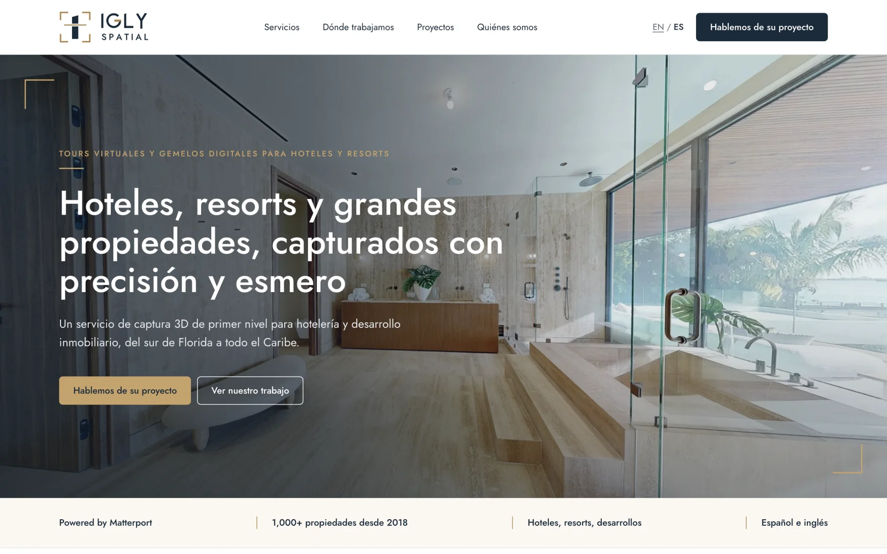

---

## Quality

Checked before launch with Lighthouse (phone settings) on every page type:

| Performance | Accessibility | Best practices | SEO |
| :---: | :---: | :---: | :---: |
| 99–100 | 100 | 100 | 100 |

No broken links or anchors across all pages, and no sideways scrolling on a 375 px phone.

---

## Technology

### Frontend
- Astro 7 (static site)
- TypeScript
- Vanilla JavaScript for the tours, filters, form, calculator and contact bar (no front-end framework)
- CSS custom properties as design tokens
- Astro image optimization (responsive WebP) and self-hosted fonts

### Services
- Vercel (hosting, automatic deploys from GitHub, cookie-free Web Analytics)
- Web3Forms (enquiry form delivery)
- Matterport (3D tours)
- Google Search Console

---

## Copyright

The IGLY Spatial name, logo, photographs, 3D tours and written content belong to IGLY3DVIRTUAL LLC (DBA IGLY Spatial) and are shown here with permission. They may not be copied, reproduced or reused.

Website design and code © 2026 Frederic G. Fleron Grignard. The source code is private.

---

## Author

Frederic G. Fleron Grignard
Software Engineer · Berlin

GitHub: https://github.com/F-Fleron-G
Portfolio: https://www.ffg-universe.com
